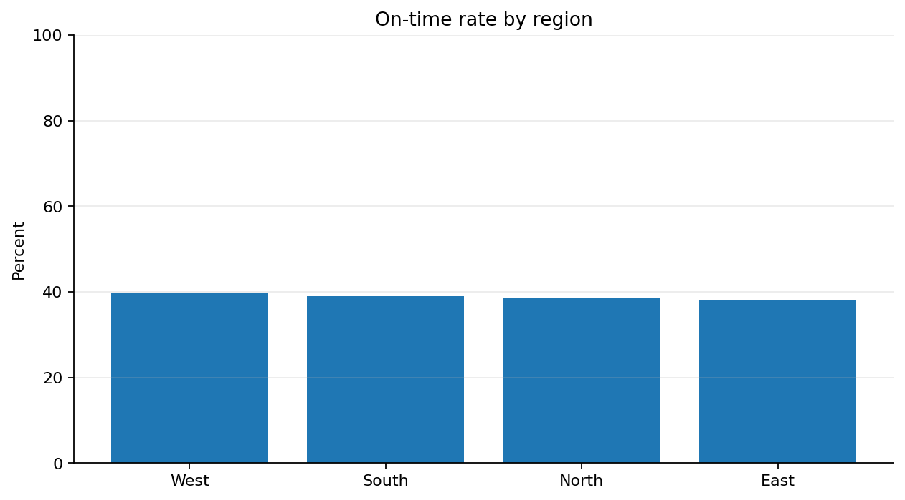
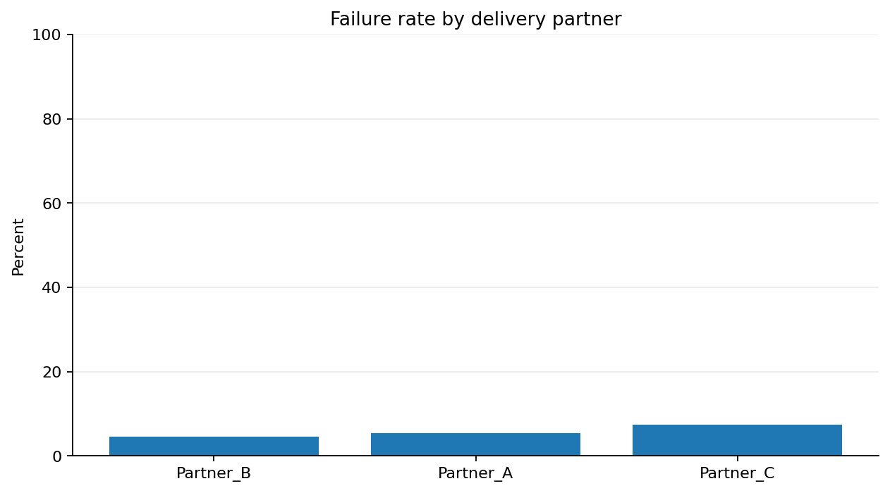

# Project 01 — Last-Mile Delivery Intelligence

A reproducible, business-focused analysis of delivery reliability and unit economics using **synthetic data only**. No employer data, internal code, or confidential metrics are used.

## Business question
How can a delivery operation improve reliability while keeping cost per successful delivery under control?

## Run it
From the repository root:

```bash
pip install -r requirements.txt
python project-01-last-mile-analytics/src/generate_data.py
python project-01-last-mile-analytics/src/analyze_deliveries.py
```

The pipeline creates 5,000 reproducible synthetic orders, validates the data, computes overall and segment-level KPIs, creates two charts, and writes reports under `reports/generated/`. SQL equivalents are in `sql/delivery_kpis.sql`.

## Business questions answered
- What are delivery success, on-time performance, delay severity, and cost per successful delivery?
- Which regions show the highest failure rates?
- Which delivery partners warrant further operational investigation?
- What actions should be tested, and which metrics should be monitored?

## Illustrative findings from the fixed-seed sample

The current 5,000-row synthetic run reports a 94.3% delivery success rate, 39.0% on-time rate among delivered orders, and average positive delay of 6.0 minutes. The East region has the highest observed failure rate in this generated sample (6.5%), while Partner C has the highest partner-level failure rate (7.4%). These are reproducible synthetic outputs—not real-world benchmarks or claims about an actual delivery business.

### Visual summary





## Example outputs
- `reports/generated/overall_metrics.json` — headline KPIs
- `reports/generated/by_region.csv` and `by_partner.csv` — segment comparisons
- `reports/generated/region_risk_prioritization.csv` and `partner_risk_prioritization.csv` — diagnostic prioritization
- `reports/generated/recommendations.json` — rule-based recommendations with caveats
- `dashboards/on_time_by_region.png` and `failure_rate_by_partner.png` — visual summaries

## Metric definitions
- **Delivery success rate:** delivered orders / all orders.
- **On-time rate among delivered:** delivered orders completed within the promised time / delivered orders. Failed orders are excluded from this denominator and tracked separately.
- **Average positive delay:** mean of `max(actual time − promised time, 0)` among delivered orders. Early deliveries contribute zero delay.
- **Cost per order:** total delivery cost / all orders.
- **Cost per successful delivery:** total delivery cost / successful deliveries; costs associated with failed attempts remain in the numerator.

## How to interpret the results
1. Start with the overall KPIs to establish the baseline.
2. Compare region and partner results, checking order counts and delivery mix.
3. Investigate failure reasons and operational conditions before acting on a segment-level signal.
4. Pilot an intervention with a defined comparison period. Track reliability and cost guardrails together.

Recommendations are generated from transparent rules, not a causal model. Segment differences are descriptive and may be affected by distance, order mix, time windows, and sample size. Validate these factors before making operational changes.

## Reproducibility and limitations
- Fixed random seed makes the synthetic dataset reproducible.
- Synthetic relationships are deliberately illustrative and are not estimates of real-world performance.
- This project is a portfolio demonstration, not a production monitoring system.
